# Evaluation Metrics: Uncertainty-Aware Active Vision for UAV-Based Infrastructure Inspection Using Deep RL

**Team 08** - 22AIE401 Reinforcement Learning - Yeseswini (Agent A, DQN), Leekhith (Agent B, PPO; integration and metrics), Mukhesh (Agent C, A2C; DeepCrack detector).

Generated by `Evaluation_Metrics/scripts/build_report.py` from the result files at git revision `5030364`. Every number in this document is read from a result file by code (see `report/report_numbers.csv`).

## 1. Project summary

A drone inspects an 8 x 16 grid of bridge-surface cells for cracks. Three cooperating agents share one Gymnasium environment: **Agent A (DQN)** decides where to fly and at which altitude, **Agent B (PPO)** refines the view of one suspicious cell with continuous distance / angle / offset actions, and **Agent C (A2C)** is a mission supervisor that chooses between the options EXPLORE (run Agent A), REFINE (run Agent B) and RETURN home. All decisions are driven by the per-cell uncertainty of a crack detector: an analytic formula, or a real-image U-Net with MC-dropout trained on DeepCrack. This document answers ten evaluation questions with metrics computed on held-out bridges, in several varying task environments, and points to recorded sessions (videos) for each insight.

## 2. Evaluation protocol

- **Held-out bridges:** seeds 2000-2099 (100 episodes per policy and scenario). Training used unseeded vectorised environments and the EvalCallback used seeds from 1000, so these bridges were never seen during training or model selection. Every policy runs on the *same* bridges, so comparisons are paired.
- **Policies:** the saved `best/best_model.zip` of every run, `deterministic=True`. Baselines are the scripted policies in `uav_inspection/env/baselines.py` (raster scans, fixed orbit, scripted approach upper bound, rule supervisor, random).
- **Validation first:** before any new evaluation, every saved result was re-computed on the original seeds with `baselines.evaluate()`: 455 of 455 checks (65 policies x 7 metrics, 19 saved files) matched within 1%; the largest relative difference was 0.00% (`results/validation.csv`).
- **Detectors:** analytic (default, success threshold mean uncertainty <= 0.32) and real-image DeepCrack cache (calibrated threshold 0.282).
- **Training seeds:** every original run used training seed 0. Extra seeds (1, 2, 3) were trained for the multi-seed analysis in Q5 where available, with identical hyperparameters (`multiseed_runs/`).
- **Hardware:** 12th Gen Intel(R) Core(TM) i5-1235U, CPU only, Python `3.12.3`, PyTorch CPU build, Stable-Baselines3. Inference latency and the multi-seed training times are laptop measurements; the original training times were measured on Google Colab.
- **Scale:** 13400 evaluation episodes in total over 8 scenarios.

**What counts as success** (design contract v1.1):

*Table 1. Success definitions per agent.*

| Agent | Episode limit | Success |
|---|---|---|
| A (navigate) | 200 steps | coverage >= 0.95 and mean uncertainty <= threshold |
| B (refine) | 30 steps | best view reached (view quality q = 4) |
| C (supervise / full) | 40 decisions | RETURN chosen with battery > 0 (safe return) |

## 3. Metric definitions

*Table 2. Metric definitions.*

| Metric | Definition / formula |
|---|---|
| Episode return | `G = sum_t r_t  (undiscounted sum of rewards in one episode)` |
| Moving-average return | `MA_k(i) = (1/k) * sum_{j=i-k+1..i} G_j ,  k = 50 training episodes; band = +-1 std of the same window` |
| Success rate | `SR = (1/N) * sum_i 1[episode i successful]` |
| Episode length | `L = number of steps (A, B) or supervisor decisions (C); reported separately for successful and failed episodes` |
| Time to goal | `mean number of low-level environment steps until success, over successful episodes only` |
| Regret (per episode) | `regret_i = G_i(benchmark) - G_i(agent) on the same bridge i;  mean and cumulative sum over i` |
| Standard deviation | `s = sqrt( sum_i (x_i - mean)^2 / (N-1) )` |
| 95% confidence interval | `mean +- t_{0.975, N-1} * s / sqrt(N)   (Student t)` |
| Robustness gap | `gap = metric(S0 nominal) - metric(perturbed scenario); positive = worse when perturbed` |
| Constraint-violation rate | `battery-empty rate = (1/N) * sum_i 1[battery_i <= 0];  OOB rate = 1000 * (out-of-bounds moves) / (low-level steps)` |
| Coverage | `fraction of the 128 cells seen at least once (task coverage);  position coverage = visited (row, col) / 128;  pose coverage = visited (altitude, row, col) / 384` |
| Visitation entropy | `H = -sum_c p_c log p_c / log(128), p_c = share of visits to cell c (1 = perfectly uniform)` |
| Sample efficiency | `environment steps until the evaluation success rate first reaches 80% / 100%` |
| Option frequency | `share of supervisor decisions given to each option (bandit-style arm-selection frequency)` |

## 4. Evaluation questions

Each question follows the same pattern: Question -> Metric -> Formula -> Table -> Plot -> Insight -> Video.

## Q1. Does each agent complete its task?

**Question.** Does each agent complete its task on unseen bridges?

**Metric.** Success rate (with 95% CI).

```
SR = (1/N) * sum_i 1[success_i]
```

*Table 3. Success rate on held-out bridges (n = 100 episodes per policy, held-out seeds 2000-2099).*

| Group | Policy | Success rate | 95% CI | Successful episodes |
|---|---|---|---|---|
| Agent A (DQN, navigate) | DQN (Agent A) | 96% | +-4 pp | 96 |
| Agent A (DQN, navigate) | raster_low | 100% | +-0 pp | 100 |
| Agent A (DQN, navigate) | raster_mid | 0% | +-0 pp | 0 |
| Agent A (DQN, navigate) | random | 0% | +-0 pp | 0 |
| Agent B (PPO, refine) | PPO (Agent B) | 100% | +-0 pp | 100 |
| Agent B (PPO, refine) | fixed_orbit | 0% | +-0 pp | 0 |
| Agent B (PPO, refine) | random | 2% | +-3 pp | 2 |
| Agent B (PPO, refine) | scripted_approach (upper bound) | 100% | +-0 pp | 100 |
| Agent C (A2C, supervise) | A2C (Agent C) | 100% | +-0 pp | 100 |
| Agent C (A2C, supervise) | rule_supervisor | 100% | +-0 pp | 100 |
| Agent C (A2C, supervise) | random | 100% | +-0 pp | 100 |
| Agent C trained with Agent A inside | A2C (C_withA) | 100% | +-0 pp | 100 |
| Agent C trained with Agent A inside | rule_supervisor (Agent A inside) | 100% | +-0 pp | 100 |
| Integration (full mode) | ALL LEARNED (C + A + B) | 100% | +-0 pp | 100 |
| Integration (full mode) | ALL SCRIPTED (rule + raster + approach) | 100% | +-0 pp | 100 |
| Integration (full mode) | ablation: C learned, A/B scripted | 100% | +-0 pp | 100 |
| Integration (full mode) | ablation: rule C, A + B learned | 100% | +-0 pp | 100 |
| Integration (full mode) | C_withA + A + B (extra) | 100% | +-0 pp | 100 |

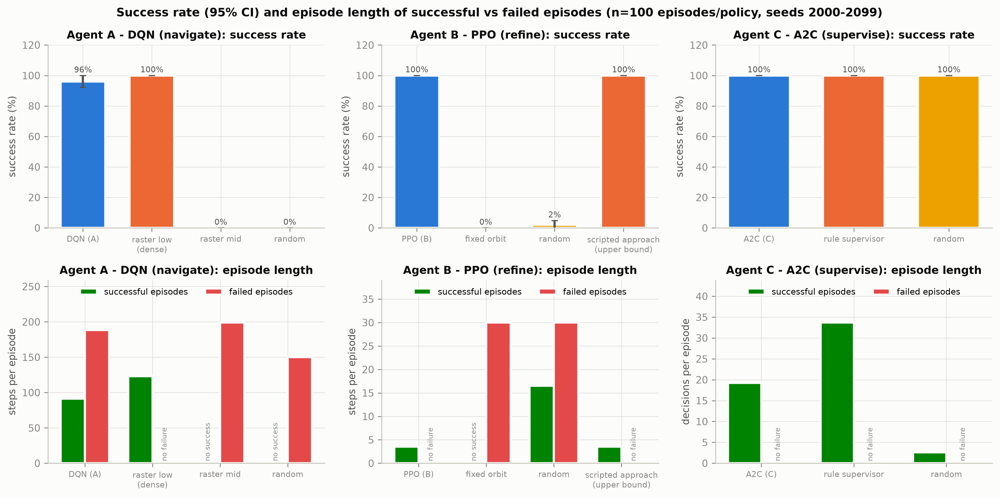

*Figure 1. Success rate and episode length of successful vs failed episodes.*

**Insight.** Agent A (DQN) succeeds on 96% of the unseen bridges, against 100% for the dense raster. On the 20 original evaluation bridges the saved result was 100%, so the agent generalises well but not perfectly: every failure is a battery-empty episode (battery-empty rate 4%), meaning that on a few bridges the learned route revisits cells and runs out of energy before the uncertainty threshold is met. Agent B (PPO) reaches the best view in 100% of episodes, the same as the privileged scripted upper bound, while the fixed orbit never does (0%). For Agent C, success means a safe return; every supervisor, including random (100%), satisfies it, because returning home early is always safe. Success rate alone therefore cannot separate the supervisors; Q2, Q3 and Q9 use return, defects found and energy instead.

**Video evidence.** `videos/V2_agentA_vs_raster_seed1000.mp4` (S0 nominal, training-eval bridge seed 1000); `videos/V3_agentA_vs_raster_heldout2005.mp4` (S0 nominal, held-out bridge seed 2005); `videos/V5_agentB_nominal_and_hardstart.mp4` (S0 nominal (seeds 2000-2001) + S5 hard start geometry (seed 2000)).

## Q2. How much reward does it collect, and is it learning?

**Question.** How much return does each agent collect, and did training converge?

**Metric.** Episode return (mean, std, median, 95% CI); learning curves with a 50-episode moving average and +-1 std band.

```
G = sum_t r_t ;  MA_50(i) = mean(G_{i-49..i})
```

*Table 4. Held-out return (n = 100 episodes per policy, held-out seeds 2000-2099).*

| Group | Policy | Mean return | Std | Median | 95% CI |
|---|---|---|---|---|---|
| Agent A (DQN, navigate) | DQN (Agent A) | 33.65 | 6.50 | 36.30 | +-1.29 |
| Agent A (DQN, navigate) | raster_low | 35.46 | 0.09 | 35.46 | +-0.02 |
| Agent A (DQN, navigate) | raster_mid | 6.23 | 0.08 | 6.23 | +-0.02 |
| Agent A (DQN, navigate) | random | -27.54 | 9.21 | -27.46 | +-1.83 |
| Agent B (PPO, refine) | PPO (Agent B) | 5.67 | 0.16 | 5.65 | +-0.03 |
| Agent B (PPO, refine) | fixed_orbit | -2.27 | 0.10 | -2.32 | +-0.02 |
| Agent B (PPO, refine) | random | -2.00 | 1.09 | -2.18 | +-0.22 |
| Agent B (PPO, refine) | scripted_approach (upper bound) | 5.68 | 0.16 | 5.66 | +-0.03 |
| Agent C (A2C, supervise) | A2C (Agent C) | 40.02 | 4.43 | 39.74 | +-0.88 |
| Agent C (A2C, supervise) | rule_supervisor | 42.62 | 3.91 | 43.51 | +-0.78 |
| Agent C (A2C, supervise) | random | 3.55 | 6.20 | 0.00 | +-1.23 |
| Agent C trained with Agent A inside | A2C (C_withA) | 44.50 | 4.11 | 45.56 | +-0.81 |
| Agent C trained with Agent A inside | rule_supervisor (Agent A inside) | 44.72 | 3.60 | 45.53 | +-0.71 |
| Integration (full mode) | ALL LEARNED (C + A + B) | 41.34 | 4.01 | 41.75 | +-0.80 |
| Integration (full mode) | ALL SCRIPTED (rule + raster + approach) | 42.62 | 3.91 | 43.51 | +-0.78 |
| Integration (full mode) | ablation: C learned, A/B scripted | 40.02 | 4.43 | 39.74 | +-0.88 |
| Integration (full mode) | ablation: rule C, A + B learned | 44.50 | 3.61 | 45.52 | +-0.72 |
| Integration (full mode) | C_withA + A + B (extra) | 44.50 | 4.11 | 45.56 | +-0.81 |

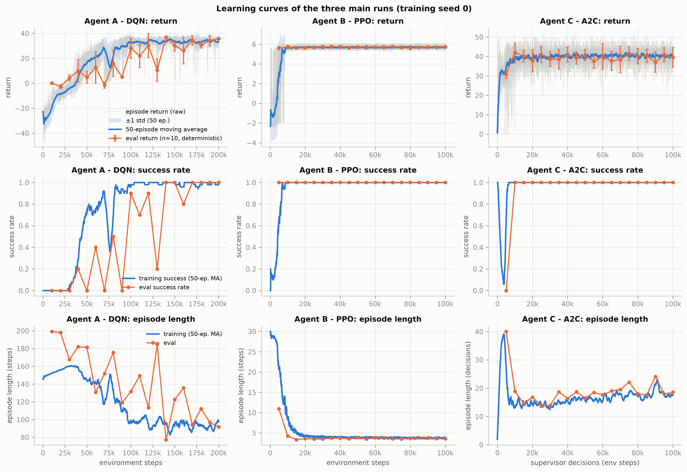

*Figure 2. Learning curves (raw return, 50-episode moving average with +-1 std band, eval return, success rate, episode length).*

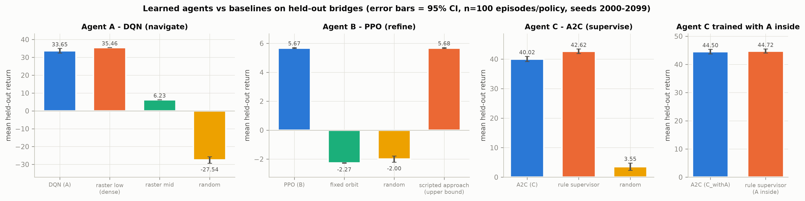

*Figure 3. Mean held-out return with 95% CI, learned agents vs baselines.*

**Insight.** All three learning curves rise and flatten. PPO converges fastest: its evaluation success first reaches 100% after 5,000 steps and its held-out return (5.67) equals the upper bound (5.68). A2C reaches a return of 40.02, below the rule supervisor (42.62). The DQN curve is the slowest and noisiest: evaluation success first reaches 100% only after 140,000 steps and the eval return still jumps between checkpoints, which is typical for vanilla DQN without Double/Dueling updates; the best checkpoint (eval return 36.89) is kept by the EvalCallback. On held-out bridges the DQN return (33.65) is slightly below the dense raster (35.46) because of the few battery-empty failures (Q1).

**Video evidence.** `videos/V2_agentA_vs_raster_seed1000.mp4` (S0 nominal, training-eval bridge seed 1000).

## Q3. How efficient is it?

**Question.** How many steps, how much energy and how much training does each agent need?

**Metric.** Episode length (successful / failed), time to goal, energy used, sample efficiency, training time, inference latency, model size.

```
time-to-goal = mean low-level steps over successful episodes ; sample efficiency = steps to first 80% / 100% eval success
```

*Table 5. Efficiency on held-out bridges (n = 100 episodes per policy, held-out seeds 2000-2099). Length is in steps for A/B and supervisor decisions for C; '-' = no such episodes.*

| Group | Policy | Length (successful) | Length (failed) | Time to goal (low-level steps) | Energy used |
|---|---|---|---|---|---|
| Agent A (DQN, navigate) | DQN (Agent A) | 91.2 | 188.5 | 91.2 | 0.531 |
| Agent A (DQN, navigate) | raster_low | 123.0 | - | 123.0 | 0.625 |
| Agent A (DQN, navigate) | raster_mid | - | 199.0 | - | 1.000 |
| Agent A (DQN, navigate) | random | - | 150.2 | - | 1.001 |
| Agent B (PPO, refine) | PPO (Agent B) | 3.6 | - | 3.6 | 0.028 |
| Agent B (PPO, refine) | fixed_orbit | - | 30.0 | - | 0.240 |
| Agent B (PPO, refine) | random | 16.5 | 30.0 | 16.5 | 0.238 |
| Agent B (PPO, refine) | scripted_approach (upper bound) | 3.5 | - | 3.5 | 0.028 |
| Agent C (A2C, supervise) | A2C (Agent C) | 19.2 | - | 91.2 | 0.513 |
| Agent C (A2C, supervise) | rule_supervisor | 33.7 | - | 148.4 | 0.956 |
| Agent C (A2C, supervise) | random | 2.6 | - | 7.1 | 0.062 |
| Agent C trained with Agent A inside | A2C (C_withA) | 29.8 | - | 144.0 | 0.835 |
| Agent C trained with Agent A inside | rule_supervisor (Agent A inside) | 32.1 | - | 140.8 | 0.922 |

*Table 6. Sample efficiency and training time (EvalCallback logs, training seed 0).*

| Run | Training steps | Steps to 80% eval success | Steps to 100% eval success | Training time (min, Colab) |
|---|---|---|---|---|
| A | 200,000 | 100,000 | 140,000 | 5.7 |
| A_learned | 500,000 | never | never | 20.4 |
| B | 100,000 | 5,000 | 5,000 | 2.1 |
| B_learned | 100,000 | 5,000 | 10,000 | 2.1 |
| C | 100,000 | 10,000 | 10,000 | 3.5 |
| C_learned | 100,000 | 10,000 | 10,000 | 3.8 |
| C_withA | 100,000 | 20,000 | 30,000 | 7.5 |

*Table 7. Model size and inference latency (1000 deterministic predict() calls, single CPU thread).*

| Agent | Algorithm | Parameters | Model file (KB) | Latency median (ms) | Latency p95 (ms) |
|---|---|---|---|---|---|
| A | DQN | 195,596 | 1,565 | 0.77 | 1.60 |
| B | PPO | 9,479 | 147 | 1.36 | 7.74 |
| C | A2C | 9,476 | 109 | 1.49 | 4.05 |
| C_withA | A2C | 9,476 | 109 | 1.51 | 2.86 |

**Insight.** On the bridges that both solve, the DQN needs 91.2 steps against 123.0 for the dense raster (change -26%) and changes energy use by -15%: it flies higher where one wide view is enough and stops as soon as the threshold is met. Its failed episodes are long (188.5 steps), i.e. they end by running out of battery. PPO needs 3.56 refinement steps, essentially the upper bound (3.52). Compared with the rule supervisor, A2C changes the number of decisions by -43%, energy by -46% and return by -6.1%. In sample efficiency PPO and A2C learn within about 5,000-10,000 steps, while the DQN needs 140,000; the real-image DQN never reached 80% eval success in 500,000 steps. All policies are small: one decision takes a few milliseconds on a laptop CPU, far below any real-time limit.

## Q4. How close is it to the best possible / best baseline?

**Question.** How much return does each learned agent lose compared with a strong benchmark on the same bridges?

**Metric.** Per-episode regret against an explicitly stated benchmark (mean, 95% CI, cumulative).

```
regret_i = G_i(benchmark) - G_i(agent) ;  cumulative regret = sum_i regret_i
```

*Table 8. Regret on held-out bridges (n = 100 episodes per policy, held-out seeds 2000-2099). Positive = the benchmark collected more return.*

| Agent | Benchmark | Mean regret | 95% CI | Cumulative regret (100 bridges) |
|---|---|---|---|---|
| DQN (Agent A) | raster_low (best baseline (dense raster)) | 1.81 | +-1.29 | 181.0 |
| PPO (Agent B) | scripted_approach (upper bound) (privileged upper bound) | 0.00 | +-0.00 | 0.3 |
| A2C (Agent C) | rule_supervisor (rule supervisor) | 2.60 | +-0.50 | 259.9 |
| A2C (C_withA) | rule_supervisor (Agent A inside) (rule supervisor with the same Agent A) | 0.22 | +-0.81 | 21.7 |
| ALL LEARNED (C + A + B) | ALL SCRIPTED (rule + raster + approach) (all-scripted system) | 1.28 | +-0.75 | 127.9 |
| ablation: rule C, A + B learned | ALL SCRIPTED (rule + raster + approach) (all-scripted system) | -1.88 | +-0.80 | -187.7 |

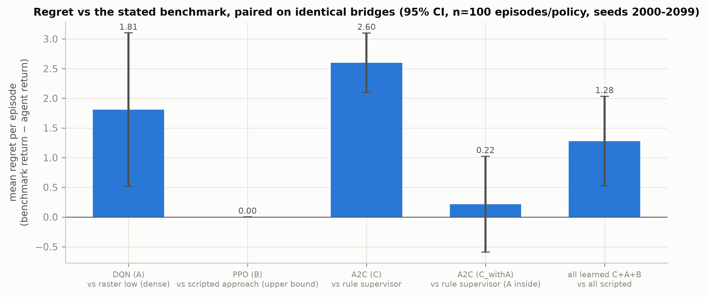

*Figure 4. Mean regret of each learned agent against its benchmark.*

**Insight.** PPO's regret against the privileged upper bound is 0.003 return per episode, so it has effectively learned the optimal approach without access to the privileged geometry. The DQN loses 1.81 per episode to the dense raster, almost entirely from its battery-empty failures. A2C trained with scripted sub-agents loses 2.60 to the rule supervisor, but the A2C retrained with Agent A inside (C_withA) reduces this to 0.22 (95% CI +-0.81, so not significantly different from zero). A negative regret means beating the benchmark: the rule supervisor with learned A and B beats the all-scripted system by 1.88 per mission, which shows that the learned navigator and refiner are better than their scripted versions.

## Q5. Is performance consistent?

**Question.** How much does performance vary between bridges and between training seeds?

**Metric.** Standard deviation, 95% confidence interval, box plots; mean +- std across training seeds.

```
s = sqrt(sum (x - mean)^2 / (N-1)) ;  CI95 = mean +- t_{0.975,N-1} s / sqrt(N)
```

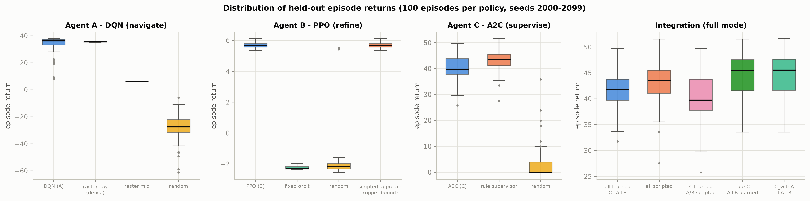

*Figure 5. Distribution of held-out episode returns per policy.*

Per-bridge variability (std and 95% CI of the return) is listed in Table 3 (Q2). The dense raster has almost no spread (std 0.09) because it flies the same path on every bridge, while the DQN adapts its route (std 6.50) and has a few low-return failure outliers. Supervisor returns vary mostly because the number of defects differs per bridge (A2C std 4.43, rule std 3.91).

*Table 9. Across training seeds: each seed evaluated on the same 100 held-out bridges; seed 0 is the original run.*

| Agent | Training seeds | Seed ids | Mean held-out return | Std across seeds | 95% CI across seeds | Mean success | Mean length |
|---|---|---|---|---|---|---|---|
| B | 4 | 0 1 2 3 | 5.675 | 0.001 | +-0.001 | 100% | 3.62 |
| C | 4 | 0 1 2 3 | 40.398 | 0.275 | +-0.437 | 100% | 18.20 |

*Table 10. Per-seed held-out results (n = 100 bridges each).*

| Agent | Training seed | Held-out return | 95% CI (over bridges) | Success |
|---|---|---|---|---|
| B | 0 | 5.675 | +-0.031 | 100% |
| B | 1 | 5.675 | +-0.031 | 100% |
| B | 2 | 5.674 | +-0.031 | 100% |
| B | 3 | 5.675 | +-0.031 | 100% |
| C | 0 | 40.024 | +-0.880 | 100% |
| C | 1 | 40.668 | +-0.861 | 100% |
| C | 2 | 40.515 | +-0.853 | 100% |
| C | 3 | 40.388 | +-0.860 | 100% |

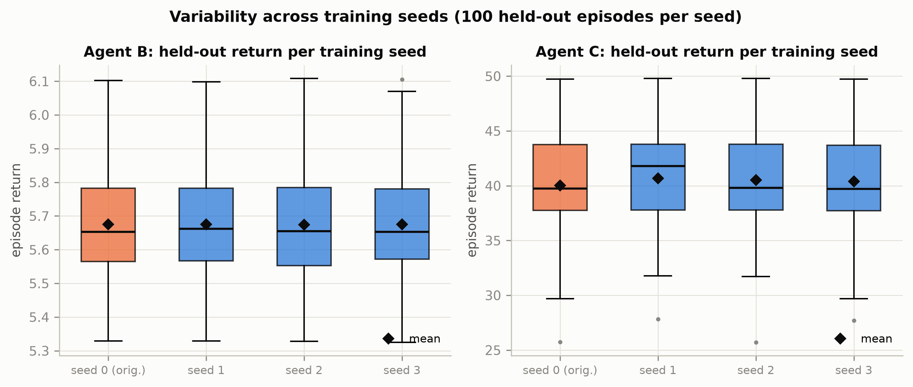

*Figure 6. Held-out return per training seed.*

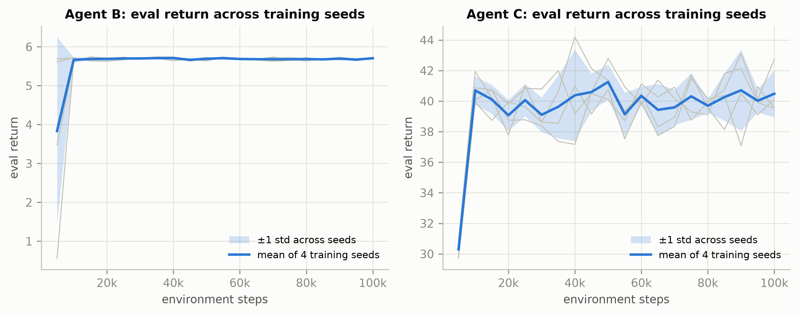

*Figure 7. Eval-return learning curves across training seeds (mean +- std).*

**Insight.** Across training seeds the final performance is very stable: PPO 5.675 +- 0.001 and A2C 40.40 +- 0.27, i.e. the difference between seeds is much smaller than the difference between bridges. Agent A (DQN) was trained with a single seed only, so its seed-to-seed variability is not measured. The seeds do differ in *how* Agent C reaches its return (Q6).

## Q6. How does it explore?

**Question.** How do the agents explore during training, and how do the trained policies use the state space and the options?

**Metric.** epsilon schedule (DQN), policy entropy (PPO, A2C), state-space coverage and visitation entropy (Agent A), option-selection frequency (Agent C).

```
H = -sum_c p_c log p_c / log 128 ;  option frequency = n(option) / n(decisions)
```

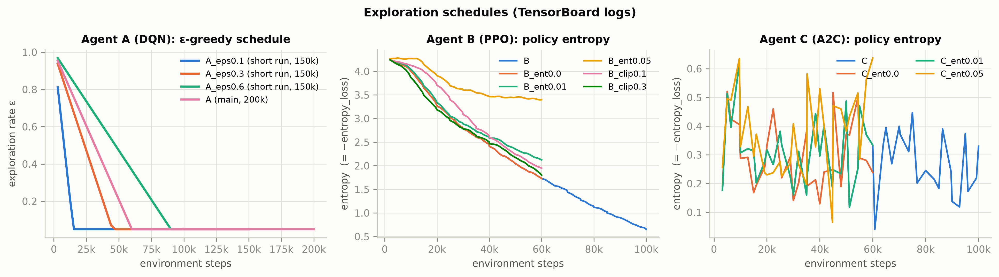

*Figure 8. epsilon schedule (DQN) and policy entropy (PPO, A2C) during training.*

*Table 11. Agent A state-space coverage and visitation entropy, mean over held-out episodes (n = 100 episodes per policy, held-out seeds 2000-2099).*

| Policy | Task coverage (cells seen) | Position coverage | Pose coverage | Visitation entropy |
|---|---|---|---|---|
| DQN (Agent A) | 0.999 | 0.489 | 0.201 | 0.799 |
| raster_low | 0.953 | 0.953 | 0.323 | 0.988 |
| raster_mid | 1.000 | 0.391 | 0.133 | 0.790 |
| random | 0.510 | 0.263 | 0.166 | 0.659 |

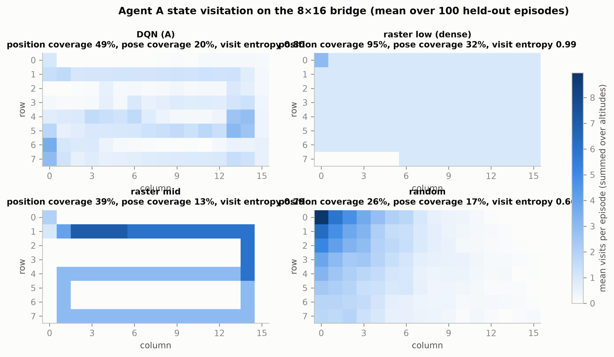

*Figure 9. Agent A state-visitation heatmaps (DQN vs raster vs random).*

*Table 12. Option-selection frequency (share of decisions, n = 100 episodes per policy, held-out seeds 2000-2099).*

| Group | Supervisor | EXPLORE | REFINE | RETURN |
|---|---|---|---|---|
| Agent C (A2C, supervise) | A2C (Agent C) | 94.8% | 0.0% | 5.2% |
| Agent C (A2C, supervise) | rule_supervisor | 65.5% | 31.5% | 3.0% |
| Agent C (A2C, supervise) | random | 31.2% | 30.8% | 38.0% |
| Agent C trained with Agent A inside | A2C (C_withA) | 96.6% | 0.0% | 3.4% |
| Agent C trained with Agent A inside | rule_supervisor (Agent A inside) | 65.6% | 31.2% | 3.1% |
| Integration (full mode) | ALL LEARNED (C + A + B) | 94.2% | 0.0% | 5.8% |
| Integration (full mode) | ALL SCRIPTED (rule + raster + approach) | 65.5% | 31.5% | 3.0% |
| Integration (full mode) | ablation: C learned, A/B scripted | 94.8% | 0.0% | 5.2% |
| Integration (full mode) | ablation: rule C, A + B learned | 65.6% | 31.3% | 3.1% |
| Integration (full mode) | C_withA + A + B (extra) | 96.6% | 0.0% | 3.4% |

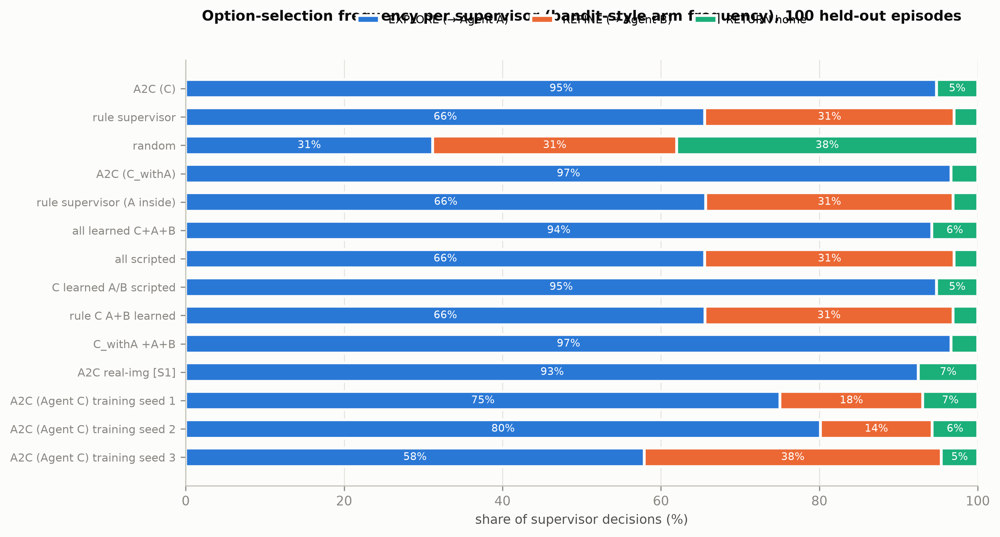

*Figure 10. Option-selection frequency per supervisor (incl. extra training seeds if available).*

**Insight.** The DQN's epsilon falls linearly from 1.0 to 0.05 over the first 30% of training; PPO's entropy falls steadily from 4.24 to 0.66 as the Gaussian policy narrows. The trained DQN sees 0.999 of the cells while physically visiting only 0.49 of the positions, against 0.95 for the dense raster: it uses higher altitudes (wider footprints) instead of flying over every cell, which is why it is more efficient. The original A2C supervisor never chooses REFINE (0.0% of decisions; the rule supervisor uses it in 31.5%). Under the reward +2 per new defect - 0.5 x energy, refining one cell costs energy and only rarely confirms a *new* defect, so its expected value is close to zero. The extra training seeds show that this is not a fixed property of A2C: with the same settings, seeds 1, 2 and 3 choose REFINE in 18.0%, 14.1% and 37.5% of decisions with practically the same return (Q5). The option mix is therefore not determined by the reward - several mixes are almost equally good, and the seed decides which one A2C settles on.

**Video evidence.** `videos/V6_agentC_mission_seed2000.mp4` (S0 nominal, held-out seed 2000); `videos/V2_agentA_vs_raster_seed1000.mp4` (S0 nominal, training-eval bridge seed 1000).

## Q7. Is it safe?

**Question.** Does the agent violate the battery and flight-area constraints?

**Metric.** Battery-empty rate (% of episodes) and out-of-bounds moves per 1000 low-level steps.

```
battery-empty rate = (1/N) sum 1[battery <= 0] ;  OOB rate = 1000 * OOB moves / steps
```

*Table 13. Constraint violations, nominal battery vs starting battery 0.6 (n = 100 episodes per policy, held-out seeds 2000-2099).*

| Scenario | Policy | Battery-empty rate | OOB moves / 1000 steps | Success |
|---|---|---|---|---|
| S0_nominal | DQN (Agent A) | 4% | 0.0 | 96% |
| S0_nominal | raster_low | 0% | 0.0 | 100% |
| S0_nominal | raster_mid | 100% | 0.0 | 0% |
| S0_nominal | random | 100% | 191.6 | 0% |
| S0_nominal | A2C (Agent C) | 0% | 0.0 | 100% |
| S0_nominal | rule_supervisor | 0% | 0.0 | 100% |
| S0_nominal | A2C (C_withA) | 0% | 0.0 | 100% |
| S0_nominal | ALL LEARNED (C + A + B) | 0% | 0.0 | 100% |
| S0_nominal | ALL SCRIPTED (rule + raster + approach) | 0% | 0.0 | 100% |
| S4_battery0.6 | DQN (Agent A) | 17% | 0.0 | 84% |
| S4_battery0.6 | raster_low | 100% | 0.0 | 0% |
| S4_battery0.6 | raster_mid | 100% | 0.0 | 0% |
| S4_battery0.6 | random | 100% | 211.8 | 0% |
| S4_battery0.6 | A2C (Agent C) | 0% | 0.0 | 100% |
| S4_battery0.6 | rule_supervisor | 0% | 0.0 | 100% |
| S4_battery0.6 | A2C (C_withA) | 24% | 0.0 | 76% |
| S4_battery0.6 | ALL LEARNED (C + A + B) | 0% | 0.0 | 100% |
| S4_battery0.6 | ALL SCRIPTED (rule + raster + approach) | 0% | 0.0 | 100% |

**Insight.** None of the learned policies ever leaves the flight area (DQN 0.0 out-of-bounds moves per 1000 steps), while the random navigator makes 192 per 1000 steps. **Key robustness finding:** when the drone starts with only 60% battery, the dense raster runs out of battery in 100% of missions (success 0%), because its fixed path needs about 0.625 of a full battery. The DQN still succeeds in 84% of missions (battery-empty 17%): its battery level is part of the observation and its reward pays for battery left, so it finishes with a cheaper route. All supervisors with a battery rule stay safe; C_withA, which explores longer, empties the battery in 24% of low-battery missions, because it was never trained with a low starting battery.

**Video evidence.** `videos/V10_agentA_battery0.6_seed2000.mp4` (S4 starting battery 0.6, held-out seed 2000).

## Q8. Does it work in different environments?

**Question.** How do the agents perform when the task environment changes?

**Metric.** Success rate and return per scenario; robustness gap (nominal - perturbed).

```
gap = metric(S0) - metric(scenario)
```

*Table 14. Varying task environments (all on held-out seeds 2000-2099, n = 100 episodes per policy).*

| Scenario | Description |
|---|---|
| S0_nominal | analytic detector, 20% defects, battery 1.0 |
| S1_learned | real-image (DeepCrack) detector |
| S2_density10 | defect density 10% |
| S2_density35 | defect density 35% |
| S3_noise0.05 | uncertainty-feature noise sigma=0.05 |
| S3_noise0.10 | uncertainty-feature noise sigma=0.10 |
| S4_battery0.6 | starting battery 0.6 |
| S5_hardstart | hard refine start (far, large angle/offset); Agent B only |

*Table 15. Success rate per scenario ('-' = not applicable).*

| Policy | S0 nominal | S1 learned | S2 density10 | S2 density35 | S3 noise0.05 | S3 noise0.10 | S4 battery0.6 | S5 hardstart |
|---|---|---|---|---|---|---|---|---|
| DQN (Agent A) | 96% | 3% | 100% | 80% | 100% | 100% | 84% | - |
| raster_low | 100% | 100% | 100% | 100% | 100% | 100% | 0% | - |
| PPO (Agent B) | 100% | 100% | 100% | 100% | 100% | 100% | 100% | 100% |
| scripted_approach (upper bound) | 100% | 100% | 100% | 100% | 100% | 100% | 100% | 100% |
| A2C (Agent C) | 100% | 100% | 100% | 100% | 100% | 100% | 100% | - |
| rule_supervisor | 100% | 100% | 100% | 100% | 100% | 100% | 100% | - |
| A2C (C_withA) | 100% | 100% | 100% | 98% | 100% | 100% | 76% | - |
| ALL LEARNED (C + A + B) | 100% | 100% | 100% | 100% | 100% | 100% | 100% | - |
| ALL SCRIPTED (rule + raster + approach) | 100% | 100% | 100% | 100% | 100% | 100% | 100% | - |

*Table 16. Mean return per scenario ('-' = not applicable).*

| Policy | S0 nominal | S1 learned | S2 density10 | S2 density35 | S3 noise0.05 | S3 noise0.10 | S4 battery0.6 | S5 hardstart |
|---|---|---|---|---|---|---|---|---|
| DQN (Agent A) | 33.65 | 7.67 | 36.70 | 26.28 | 36.52 | 35.97 | 25.25 | - |
| raster_low | 35.46 | 33.75 | 35.78 | 34.96 | 35.46 | 35.46 | 17.19 | - |
| PPO (Agent B) | 5.67 | 5.36 | 5.67 | 5.74 | 5.68 | 5.67 | 5.67 | 5.76 |
| scripted_approach (upper bound) | 5.68 | 5.36 | 5.67 | 5.74 | 5.68 | 5.68 | 5.68 | 5.77 |
| A2C (Agent C) | 40.02 | 41.51 | 19.29 | 68.88 | 40.03 | 40.04 | 38.64 | - |
| rule_supervisor | 42.62 | 41.68 | 21.38 | 72.98 | 42.62 | 42.62 | 41.35 | - |
| A2C (C_withA) | 44.50 | 32.70 | 21.53 | 74.78 | 44.52 | 44.43 | 39.62 | - |
| ALL LEARNED (C + A + B) | 41.34 | 32.29 | 19.91 | 69.62 | 41.14 | 40.71 | 36.29 | - |
| ALL SCRIPTED (rule + raster + approach) | 42.62 | 41.68 | 21.38 | 72.98 | 42.62 | 42.62 | 41.35 | - |

*Table 17. Robustness gap of the learned policies (nominal minus perturbed; positive = worse).*

| Learned policy | Scenario | Return gap | Success gap |
|---|---|---|---|
| DQN (Agent A) | S1_learned | +25.98 | +93 pp |
| DQN (Agent A) | S2_density10 | -3.05 | -4 pp |
| DQN (Agent A) | S2_density35 | +7.37 | +16 pp |
| DQN (Agent A) | S3_noise0.05 | -2.87 | -4 pp |
| DQN (Agent A) | S3_noise0.10 | -2.32 | -4 pp |
| DQN (Agent A) | S4_battery0.6 | +8.40 | +12 pp |
| PPO (Agent B) | S1_learned | +0.32 | +0 pp |
| PPO (Agent B) | S2_density10 | +0.00 | +0 pp |
| PPO (Agent B) | S2_density35 | -0.06 | +0 pp |
| PPO (Agent B) | S3_noise0.05 | -0.00 | +0 pp |
| PPO (Agent B) | S3_noise0.10 | -0.00 | +0 pp |
| PPO (Agent B) | S4_battery0.6 | -0.00 | +0 pp |
| PPO (Agent B) | S5_hardstart | -0.09 | +0 pp |
| A2C (Agent C) | S1_learned | -1.49 | +0 pp |
| A2C (Agent C) | S2_density10 | +20.74 | +0 pp |
| A2C (Agent C) | S2_density35 | -28.86 | +0 pp |
| A2C (Agent C) | S3_noise0.05 | -0.00 | +0 pp |
| A2C (Agent C) | S3_noise0.10 | -0.02 | +0 pp |
| A2C (Agent C) | S4_battery0.6 | +1.39 | +0 pp |
| ALL LEARNED (C + A + B) | S1_learned | +9.06 | +0 pp |
| ALL LEARNED (C + A + B) | S2_density10 | +21.44 | +0 pp |
| ALL LEARNED (C + A + B) | S2_density35 | -28.28 | +0 pp |
| ALL LEARNED (C + A + B) | S3_noise0.05 | +0.20 | +0 pp |
| ALL LEARNED (C + A + B) | S3_noise0.10 | +0.63 | +0 pp |
| ALL LEARNED (C + A + B) | S4_battery0.6 | +5.06 | +0 pp |

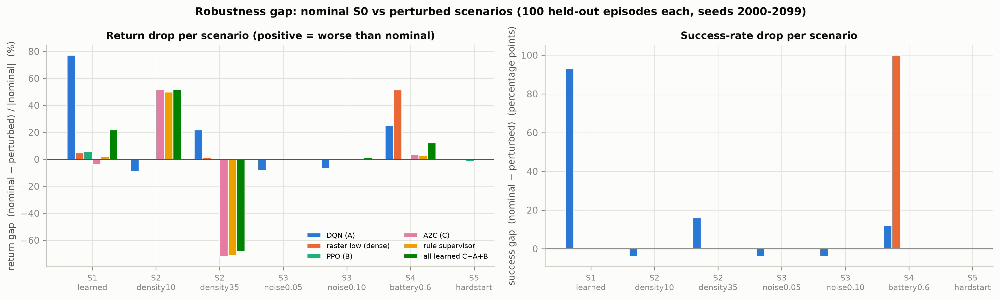

*Figure 11. Robustness gap per scenario (relative return drop and success drop).*

*Table 18. Real-image (DeepCrack) detector, analytic-trained and real-image-trained models (n = 100 each).*

| Group | Policy | Success | Return | Length | Energy |
|---|---|---|---|---|---|
| Agent A (DQN, navigate) | DQN (Agent A) | 3% | 7.67 | 190.8 | 0.992 |
| Agent A (DQN, navigate) | DQN (Agent A, real-image trained) | 20% | 14.58 | 148.9 | 0.910 |
| Agent A (DQN, navigate) | raster_low | 100% | 33.75 | 123.4 | 0.627 |
| Agent A (DQN, navigate) | raster_mid | 20% | 14.01 | 168.7 | 0.849 |
| Agent A (DQN, navigate) | random | 0% | -27.83 | 150.2 | 1.001 |
| Agent B (PPO, refine) | PPO (Agent B) | 100% | 5.36 | 3.7 | 0.030 |
| Agent B (PPO, refine) | PPO (Agent B, real-image trained) | 100% | 5.36 | 3.6 | 0.029 |
| Agent B (PPO, refine) | fixed_orbit | 0% | -2.32 | 30.0 | 0.240 |
| Agent B (PPO, refine) | random | 0% | -2.25 | 30.0 | 0.240 |
| Agent B (PPO, refine) | scripted_approach (upper bound) | 100% | 5.36 | 3.6 | 0.029 |
| Agent C (A2C, supervise) | A2C (Agent C) | 100% | 41.51 | 17.8 | 0.494 |
| Agent C (A2C, supervise) | A2C (Agent C, real-image trained) | 100% | 41.58 | 13.4 | 0.350 |
| Agent C (A2C, supervise) | rule_supervisor | 100% | 41.68 | 34.5 | 0.951 |
| Agent C (A2C, supervise) | random | 100% | 3.51 | 2.6 | 0.060 |

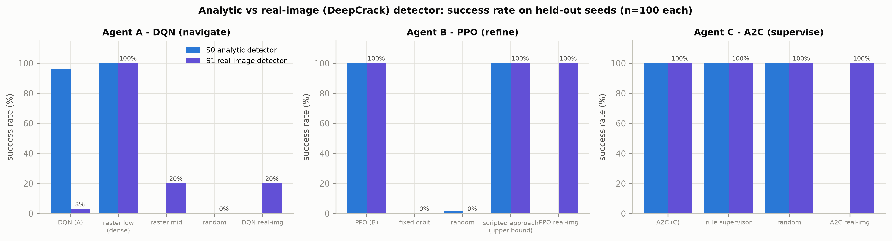

*Figure 12. Success rate with the analytic vs the real-image detector.*

**Insight.** **Real images are the hardest change for Agent A.** The analytic-trained DQN drops to 3% success and even the DQN trained on real-image uncertainty reaches only 20%, while the dense raster keeps 100%. Why: the U-Net's uncertainty is weaker and noisier than the analytic formula, the calibrated threshold is stricter, and the high and mid altitudes map to the two worst view qualities (q0, q1), so meeting the threshold requires flying low over almost every cell - exactly what the raster does by design. Agents B and C transfer well: PPO keeps 100% success and A2C a return of 41.51 vs 41.68 for the rule supervisor. With **35% defects** the DQN's success falls to 80%: more defective cells keep the mean uncertainty high (defects are more ambiguous in the detector model), so it needs more low passes than its learned budget allows. Returns of the supervisors rise or fall with defect density simply because the reward counts defects (the return gap is not a failure there). **Observation noise** on the uncertainty features (sigma 0.05 and 0.10) does not hurt any agent (DQN success 100% at the larger sigma). **Hard start geometry** leaves PPO at 100% success in 4.76 steps (upper bound 4.75). The low-battery result is discussed in Q7.

**Video evidence.** `videos/V4_agentA_real_images_seed2000.mp4` (S1 real-image (DeepCrack) detector, held-out seed 2000); `videos/V8_detector_q0_to_q4.mp4` (real DeepCrack test patches); `videos/V9_agentA_density35_seed2013.mp4` (S2 defect density 35%, held-out seed 2013 (a DQN failure case)); `videos/V10_agentA_battery0.6_seed2000.mp4` (S4 starting battery 0.6, held-out seed 2000); `videos/V5_agentB_nominal_and_hardstart.mp4` (S0 nominal (seeds 2000-2001) + S5 hard start geometry (seed 2000)).

## Q9. Do the agents work together?

**Question.** Does the hierarchy of three learned agents work, and which learned parts help?

**Metric.** Integration ablation in full mode: return, decisions, defects found, energy, mIoU, REFINE share.

```
same 100 bridges for every configuration (paired)
```

*Table 19. Integration ablation in full mode (n = 100 episodes per policy, held-out seeds 2000-2099).*

| Configuration | Return | Decisions | Low-level steps | Defects (of 26) | Energy | mIoU | REFINE share |
|---|---|---|---|---|---|---|---|
| ALL LEARNED (C + A + B) | 41.34 | 17.2 | 81.1 | 21.72 | 0.513 | 0.529 | 0.0% |
| ALL SCRIPTED (rule + raster + approach) | 42.62 | 33.7 | 148.4 | 22.47 | 0.956 | 0.599 | 31.5% |
| ablation: C learned, A/B scripted | 40.02 | 19.2 | 91.2 | 21.06 | 0.513 | 0.501 | 0.0% |
| ablation: rule C, A + B learned | 44.50 | 32.0 | 140.6 | 23.40 | 0.922 | 0.619 | 31.3% |
| C_withA + A + B (extra) | 44.50 | 29.8 | 144.0 | 23.38 | 0.835 | 0.597 | 0.0% |

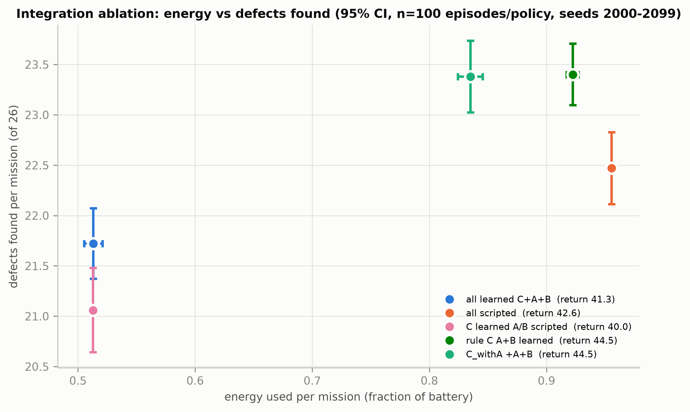

*Figure 13. Energy vs defects found per configuration.*

**Insight.** Compared with the all-scripted system, the fully learned hierarchy (C + A + B) completes every mission while changing energy by -46% and the number of decisions by -49%, at a cost of -0.75 defects found per mission. The best configuration is the rule supervisor with learned A and B (return 44.50, defects 23.40), which shows that the learned navigator and refiner are individually better than the scripted ones. The weak link is the supervisor: the original A2C never calls REFINE (0.0%), so Agent B is never used inside the learned hierarchy and the A2C returns home early to save energy. The A2C retrained with Agent A inside (C_withA) explores longer and gets a return of 44.50, the same mean return as the best configuration, but it also does not use REFINE.

**Video evidence.** `videos/V7_full_mission_learned_vs_rule.mp4` (S0 nominal, held-out seed 2000, full mode).

## Q10. Is training healthy?

These are **training diagnostics**, not task performance: they show whether the optimisation behaved well.

**Question.** Did the losses, value estimates and policy updates behave as expected, and are the results sensitive to hyperparameters?

**Metric.** DQN loss (TD-error proxy); PPO policy-gradient loss, value loss, entropy, approximate KL, clip fraction, explained variance; A2C policy loss, value loss, entropy, explained variance; sensitivity studies.

```
explained variance = 1 - Var(returns - V) / Var(returns) ;  approx KL ~ E[(r - 1) - log r], r = pi_new/pi_old
```

*Table 20. Training diagnostics from TensorBoard (main runs, training seed 0).*

| Diagnostic | Mean of first 10 logs | Mean of last 10 logs | Maximum |
|---|---|---|---|
| DQN loss | 0.0133 | 0.0278 | 0.3312 |
| PPO value loss | 3.8424 | 0.0013 | 9.8718 |
| PPO approx. KL | 0.0144 | 0.0122 | 0.0229 |
| PPO clip fraction | 0.1566 | 0.1364 | 0.2452 |
| PPO explained variance | 0.0093 | 0.9656 | 0.9725 |
| A2C value loss | 36.3799 | 2.9513 | 128.6563 |
| A2C explained variance | 0.8458 | 0.9732 | 0.9955 |

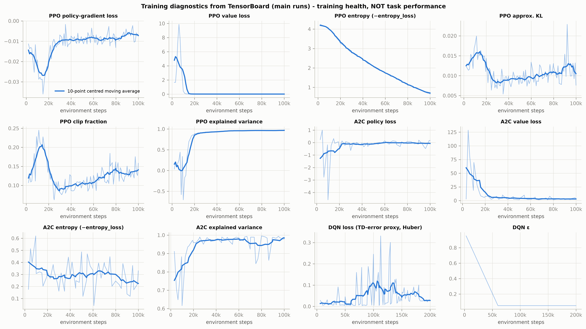

*Figure 14. PPO / A2C / DQN training diagnostics.*

*Table 21. Hyperparameter sensitivity (CO5), every run evaluated on the 100 held-out bridges.*

| Run | Setting | Training steps | Held-out return | 95% CI | Success | Length |
|---|---|---|---|---|---|---|
| A_eps0.1 | eps_fraction 0.1 | 150,000 (short run) | 36.79 | +-1.09 | 97% | 78.5 |
| A_eps0.3 | eps_fraction 0.3 | 150,000 (short run) | 34.55 | +-0.90 | 99% | 92.5 |
| A_eps0.6 | eps_fraction 0.6 | 150,000 (short run) | 30.89 | +-1.83 | 90% | 111.2 |
| A | eps_fraction 0.3 | 200,000 | 33.65 | +-1.29 | 96% | 95.1 |
| B_ent0.0 | ent 0, clip 0.2 | 60,000 (short run) | 5.67 | +-0.03 | 100% | 3.6 |
| B_ent0.01 | ent 0.01, clip 0.2 | 60,000 (short run) | 5.67 | +-0.03 | 100% | 3.6 |
| B_ent0.05 | ent 0.05, clip 0.2 | 60,000 (short run) | 5.67 | +-0.03 | 100% | 3.6 |
| B_clip0.1 | ent 0, clip 0.1 | 60,000 (short run) | 5.68 | +-0.03 | 100% | 3.5 |
| B_clip0.3 | ent 0, clip 0.3 | 60,000 (short run) | 5.67 | +-0.03 | 100% | 3.6 |
| B | ent 0, clip 0.2 | 100,000 | 5.67 | +-0.03 | 100% | 3.6 |
| C_ent0.0 | ent 0 | 60,000 (short run) | 40.10 | +-0.88 | 100% | 13.2 |
| C_ent0.01 | ent 0.01 | 60,000 (short run) | 40.52 | +-0.86 | 100% | 17.7 |
| C_ent0.05 | ent 0.05 | 60,000 (short run) | 40.42 | +-0.86 | 100% | 16.7 |
| C | ent 0.01 | 100,000 | 40.02 | +-0.88 | 100% | 19.2 |

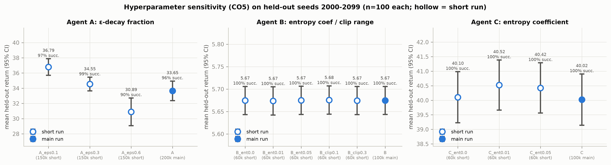

*Figure 15. Hyperparameter sensitivity (held-out return with 95% CI).*

**Insight.** PPO is healthy: the explained variance rises to 0.966, the approximate KL stays small (0.0122 at the end) and the clip fraction stays near 0.14, so updates are neither too large nor too timid. A2C's value function also fits well (explained variance 0.973). The DQN loss *rises* after the epsilon schedule ends (peak 0.331) and falls again at the end, which is normal: once the agent reaches the large success bonus, the Q-targets grow and so do the TD errors; together with the noisy eval curve this is why the best checkpoint is used. Sensitivity: a shorter epsilon decay gives the best DQN (eps_fraction 0.1: return 36.79, 0.6: 30.89), because a long exploration phase leaves too little time to exploit. PPO is insensitive to its entropy coefficient and clip range (all returns between 5.67 and 5.68), and A2C to its entropy coefficient (40.02-40.52). The sensitivity runs are shorter than the main runs, as marked.

## 5. Key findings

- **Agent B (PPO) is solved:** 100% success, regret 0.003 against the privileged upper bound, robust to a hard start, real images, hyperparameters and training seeds.
- **Agent A (DQN) is more efficient but less reliable than the dense raster:** steps -26% and energy -15% on solved bridges, but 96% vs 100% success on unseen bridges.
- **Low battery favours the learned planner:** at 60% starting battery the raster fails 100% of missions, the DQN succeeds in 84%.
- **Real images break Agent A:** 20% success even when trained on the real-image detector; B and C transfer without loss.
- **The learned hierarchy saves energy:** energy -46% vs the scripted system, defects found -0.75; learned A + B under a rule supervisor is the best configuration overall.
- **The original A2C never uses REFINE** (0.0% of decisions), so Agent B is idle inside the learned hierarchy. Other training seeds do use it (18%-38%) with the same return: the reward does not make REFINE clearly worthwhile.
- **Success rate is not enough for Agent C:** every supervisor, even random, returns safely; return, defects and energy are the informative metrics.

## 6. Limitations and future work

- **Analytic detector for most results.** The main numbers use a formula-based uncertainty; with the real-image detector Agent A fails most missions (Q8).
- **Observation noise (S3) only reaches Agent C in supervise/full mode.** The sub-agents A and B read their observations inside the environment, so in the hierarchical modes only the supervisor's observation is noised; the S3 numbers for C, C_withA and full therefore test the supervisor alone. In navigate and refine mode the noise does reach Agents A and B.
- **Training seeds.** All original runs used seed 0. Extra seeds exist only for the agents listed in Q5; the multi-seed training times were measured with several runs in parallel on a laptop and are not comparable with the Colab times.
- **Simplified world.** 2-D grid, no wind, collisions or 3-D geometry; energy is a fixed cost per action.
- **Vanilla DQN** (no Double/Dueling) gives noisy evaluation; the best checkpoint is used.
- **Reward design for Agent C** gives REFINE almost no net value, so whether the supervisor uses Agent B depends on the training seed. A reward for uncertainty reduction or confirmed defects would make B's role explicit.
- **Future work:** Double/Dueling DQN, a battery-randomised curriculum for Agent A and C_withA, a curriculum from the analytic to the real-image detector, more training seeds, and a 3-D simulator (AirSim).

## 7. Appendix

### 7.1 Video index

*Table 22. Recorded experimental sessions (see videos/video_index.md for results and insights).*

| File | Scenario | Question | Metric to watch | Duration (s) |
|---|---|---|---|---|
| videos/V1_env_tour.mp4 | S0 nominal (seed 1000) | What is the task and what do we measure? | coverage, mean uncertainty, energy, return | 33 |
| videos/V2_agentA_vs_raster_seed1000.mp4 | S0 nominal, training-eval bridge seed 1000 | Does Agent A finish the inspection with fewer steps? | steps, energy, success | 33 |
| videos/V3_agentA_vs_raster_heldout2005.mp4 | S0 nominal, held-out bridge seed 2005 | Does Agent A generalise to an unseen bridge? | success, steps, energy | 33 |
| videos/V4_agentA_real_images_seed2000.mp4 | S1 real-image (DeepCrack) detector, held-out seed 2000 | Does Agent A work with real-image uncertainty? | success (mean uncertainty must reach the calibrated 0.282) | 32 |
| videos/V5_agentB_nominal_and_hardstart.mp4 | S0 nominal (seeds 2000-2001) + S5 hard start geometry (seed 2000) | Does PPO reach the best view (q=4), even from a hard start? | steps to q=4, return | 32 |
| videos/V6_agentC_mission_seed2000.mp4 | S0 nominal, held-out seed 2000 | Which options does the A2C supervisor choose? | option sequence (EXPLORE / REFINE / RETURN), defects, energy | 33 |
| videos/V7_full_mission_learned_vs_rule.mp4 | S0 nominal, held-out seed 2000, full mode | Do the three agents work together? | defects found, energy, whether Agent B is ever called | 33 |
| videos/V8_detector_q0_to_q4.mp4 | real DeepCrack test patches | Why are real images harder? | uncertainty and detection at view quality q0..q4 | 33 |
| videos/V9_agentA_density35_seed2013.mp4 | S2 defect density 35%, held-out seed 2013 (a DQN failure case) | Does Agent A cope with many more defects? | success, battery | 33 |
| videos/V10_agentA_battery0.6_seed2000.mp4 | S4 starting battery 0.6, held-out seed 2000 | Is Agent A safe when the battery is low? | battery-empty, success | 32 |

### 7.2 File map

*Table 23. Where everything is.*

| Path (in Evaluation_Metrics/) | Content |
|---|---|
| scripts/common.py | paths, ScenarioEnv subclass, UncertaintyNoise wrapper, instrumented episode runner, CI |
| scripts/validate.py | Phase 1: re-evaluation on the original seeds -> results/validation.csv |
| scripts/evaluate_all.py, suites.py | Phase 2: held-out evaluation -> episodes_*, summary_*, regret, violations |
| scripts/evaluate_scenarios.py | Phase 3: scenarios S1-S5 -> scenario_summary.csv, robustness_gap.csv |
| scripts/training_diagnostics.py | Phase 4: curves, TensorBoard scalars, sample efficiency, sensitivity, model size |
| scripts/multiseed.py | Phase 5: extra training seeds -> multiseed_runs/, multiseed_*.csv |
| scripts/plots.py | Phase 6: plots/*.png + plots/plot_index.csv |
| scripts/make_videos.py | Phase 7: videos/*.mp4, video_runs.csv |
| scripts/build_report.py | Phase 8: this document, report_numbers.csv, video index and narration |
| report/known_issues.md | mismatches and limitations found while evaluating |
| tests/test_eval.py | pytest checks (validation, numbers, files, no changes outside Evaluation_Metrics/) |

### 7.3 How to reproduce

From the repository root, with the venv `%USERPROFILE%\.venvs\uav_demo` activated:

```
python Evaluation_Metrics/run_all.py            # phases 1,2,3,4,6,7,8 (add --multiseed for phase 5)
```

```
python -m pytest Evaluation_Metrics/tests -q     # verification
```
